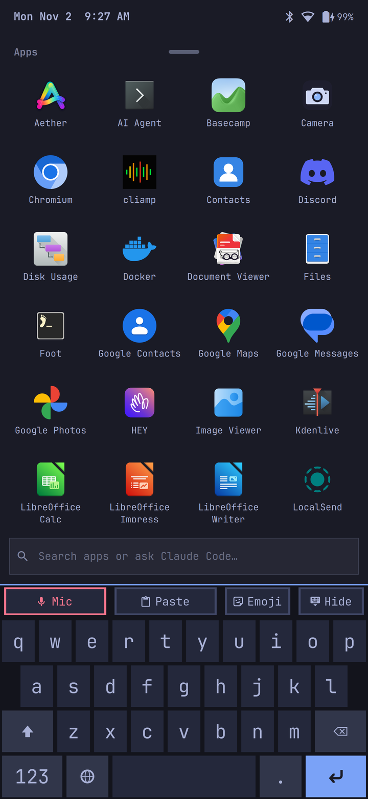
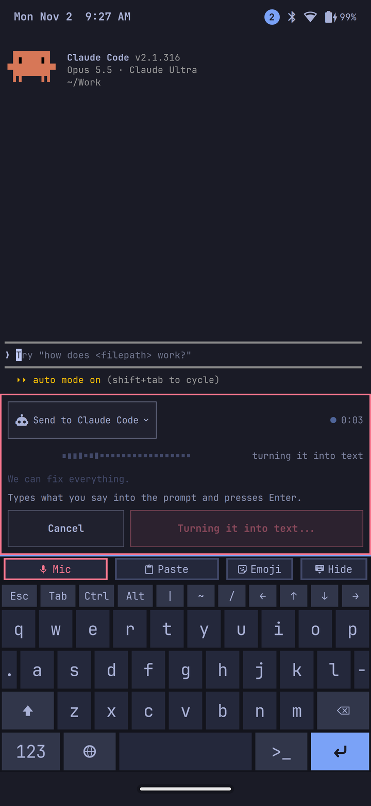

# Omarchy Mobile

Native Omarchy on mobile devices: Arch Linux ARM, Hyprland and Omarchy's own packages running directly on the device with a mainline kernel, with Android apps in Waydroid as a later goal. The reference device is the Pixel 7 Pro (cheetah, gs201); community ports cover more Pixels, and the first non-Pixel ports are in review ([docs/DEVICES.md](docs/DEVICES.md)).

<p align="center">
  
  
  
  
</p>

What works on each phone, and the notes behind it: [docs/DEVICES.md](docs/DEVICES.md). What's next: [docs/ROADMAP.md](docs/ROADMAP.md).

## Quick start

**Installing a release?** Follow [docs/INSTALL.md](docs/INSTALL.md): it installs a downloaded, signed release bundle, with no build and no checkout of this repository. The steps below build everything yourself.

The installer is new: expect rough edges. You need a Pixel 7 Pro with an unlocked bootloader, an Omarchy (Arch) laptop with Docker, `android-tools` and `e2fsprogs`, and Google's factory image for the phone. Stock Android stays on slot A as the way back; installing erases `userdata`.

```sh
tools/build-packages                 # Omarchy Mobile's packages for aarch64 (out/repo)
tools/build-rootfs                   # the root image: Arch Linux ARM, Omarchy, our packages
tools/install-phone --dry-run        # phone in fastboot: checks it, asks for your user, shows every command
tools/install-phone                  # writes only slot B's boot images and userdata
# after the first boot: a read-only backup of the modem's partitions into DIR (below)
tools/phone-provision --first-install --nv-backup DIR FACTORY.zip   # firmware from your own factory image, NV sums from DIR
```

**Back up before you provision.** After the first boot, copy the modem's partitions (`persist`, `modem_a`, `modem_b`, `efs`, `efs_backup`, `modem_userdata`) and `devinfo` off the phone, read-only, into a new directory of your own outside the repository, with a `SHA256SUMS` file. The commands, which check each copy against the phone, are in [REINSTALL-RUNBOOK](device/cheetah/REINSTALL-RUNBOOK.md) section 4a. `tools/phone-provision` doesn't take this backup for you: it holds your IMEI, so you keep it, and never commit, post or attach it. `--nv-backup DIR` puts its six NV checksums on the phone (the modem starts only from copies of its partitions that still match them); the modem's board id is read from the phone's own bootconfig and written on the phone, never printed. A reinstall of your own takes the same steps; only the runbook's reinstall from Phase 0's `phone-config.tar` (a backup of the hand-installed system) restores from that tar instead.

The kernel and boot images come from `bin/omamobile kernel`, `modules`, `initramfs` and `images` (CONTRIBUTING.md §4). Step by step, with what to expect at each point: [device/cheetah/REINSTALL-RUNBOOK.md](device/cheetah/REINSTALL-RUNBOOK.md).

## Layout

| Path | What it is |
| --- | --- |
| `bin/omamobile` | Build and flash tooling: `capture`, `kernel`, `modules`, `initramfs`, `images`, `flash`, `push`, `kexec`, `fastboot` |
| `tools/build-packages`, `tools/build-rootfs`, `tools/install-phone`, `tools/phone-provision`, `tools/make-bundle` | The installer: aarch64 packages and the root image built on the laptop, the narrow fastboot installer, per-phone provisioning, release bundles (`rootfs/` holds the image's package lists; `tests/` their tests) |
| `tools/` | Staged bring-up and capture tools, on-phone probes, firmware extraction from the user's factory image, package and repository helpers |
| `packages/` | pacman packages: `omamobile-shell` (the phone profile for Omarchy's shell), `omamobile-apps` (the mobile apps desktop Omarchy lacks: Camera, Maps, NFC), `omacam` (the camera app, built from its own repository), `omamobile-device-cheetah` (Pixel 7 Pro support), `omamobile-device-felix` (Pixel Fold), `omamobile-sensors` (sensors and auto-rotate through the AoC), `omamobile-gnss` (location on demand), `omamobile-mirror` (the phone's screen and input on a computer over USB, VNC), `omamobile-remote` and a click-patched `wlrctl` (use the phone over ssh from a script or an agent; opt-in, [docs/REMOTE-TESTING.md](docs/REMOTE-TESTING.md)), `omamobile-audio` (PipeWire and speaker protection), `omamobile-speaker-tuning` (stock's speaker tuning, off by default), `omamobile-fingerprint` with a patched `libfprint`, `omamobile-modem` (the modem's vendor chroot profile), `omamobile-modem-sit` (the SIT client daemon; talks to the modem, registration untested), `omamobile-mmd` (ModemManager's D-Bus API in front of it, for GNOME Calls, Chatty and NetworkManager), `neard`, `omamobile-keyring` (the `[omamobile]` repository's signing key), patched `mesa` and `hyprland`. `tools/phone-install-package` builds one on the phone and installs it |
| `patches/omarchy/` | Changes to Omarchy for touch devices, to send upstream (`bridge-*` stopgaps are retained only in the legacy 4.0.6 family); a link to the 4.5 family in `packages/omamobile-omarchy/patches/`. The installed Omarchy version selects the family: phones run 4.5 and `patches/`, where fixes go, and one still on 4.0.6 uses `legacy-4.0.6/` until its next update; the pacman hook re-applies the selected family after upgrades |
| `bin/lineage-ref` | Builds LineageOS for the phone. Used as a rooted reference Android (M0) and, later, for Waydroid images |
| `kernel/configs/` | Our kernel config fragment, merged on top of arm64 `defconfig` |
| `device/cheetah/` | Pixel 7 Pro bring-up notes, one plan per subsystem, overlays, the initramfs and the device descriptor (`device.conf`) |
| `device/<codename>/` | The other devices' descriptors, notes and bring-up plans (`felix`, `oriole`, `flame`, `husky`, `tegu`) |
| `omamobile.conf` | Shared settings (source dir, jobs, container image). Override in `omamobile.local.conf` |
| `docker/` | Ubuntu 24.04 build environment |
| `docs/DEVICES.md` | Supported-devices matrix |
| `docs/ROADMAP.md` | Where things stand and the plan to a working phone |
| `docs/DEMO.md` | Fictional demo data, screenshots and screen recordings for the website and videos (`tools/phone-demo`) |
| `docs/RELEASES.md` | How builds and releases work for several devices: device descriptors, the kernel package, release bundles |

Large trees live outside the repo: the Android-side sources, images and captures under `~/android/`, and the kernel under `~/omamobile-kernel/` (`~/android/mainline` on setups from before 2026-10-29; the tools find either):

| Path | Contents |
| --- | --- |
| `~/android/omamobile` | LineageOS 24.0 source. Includes Google's GPL Pixel 7 kernel at `out-kernel/google/gs-6.1` |
| `~/omamobile-kernel/linux` | Our kernel repo: branch `omamobile` on mainline v7.3-rc6 (remote `upstream` is Linus's tree), one commit per subsystem so patches can go upstream. Published to [derekross/linux-omarchy-mobile](https://github.com/derekross/linux-omarchy-mobile) on a squashed upstream base; pull requests and the maintainer's fast-forwards (`tools/publish-kernel`) move it forward, and releases are tags on it |
| `~/omamobile-kernel/pmos-tensor` | postmarketOS Tensor kernel, for reference |
| `~/android/reference` | Captures from the phone. Contains serial numbers and partition backups: never commit |
| `~/android/factory` | Verified stock factory images, used to restore the phone |

## Ground rules

- We only ever flash the boot images and userdata. Never `bootloader`, `radio`, `devinfo`, `persist` or calibration partitions.
- **Licensing:** this repository is MIT ([LICENSE](LICENSE)) except where a file's SPDX header says otherwise. Kernel patches (and the board dtbo source) are GPL-2.0. The port of Google's Apache-2.0 boot-control code keeps that licence and Google's notice (`packages/omamobile-device-cheetah/src/omamobile-bootctl.c`). Every file we write carries an SPDX header.
- Google's proprietary firmware and binaries are never committed: our scripts extract them from the user's own factory image.
- No code from unlicensed sources. Google's GPL kernel, upstream Linux, postmarketOS and Mesa are fine.

## Contributing

Bringing up another device, fixing a driver or improving the phone shell: start with [CONTRIBUTING.md](CONTRIBUTING.md). It covers the safety model (stock Android stays on slot A, the read-only storage guard, backups, dead-man switches), the build and flash loop, a step-by-step guide to bringing up a new device, and how to submit kernel and package changes. AI coding agents should also read [AGENTS.md](AGENTS.md). The status of each device is in [docs/DEVICES.md](docs/DEVICES.md), and what's next in [docs/ROADMAP.md](docs/ROADMAP.md).
