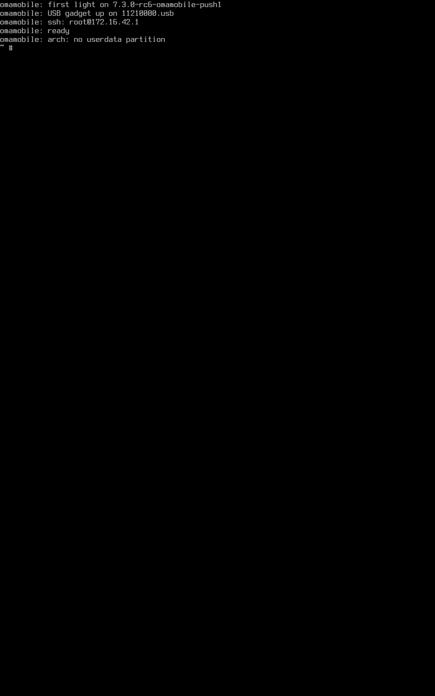
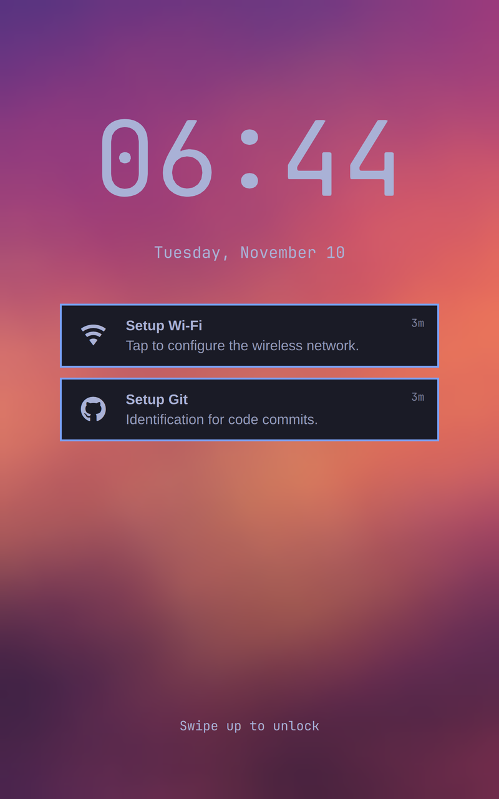

<!-- SPDX-License-Identifier: MIT -->
# Pixel Tablet (tangorpro) first light

Status (2026-11-26): slot B boots the Arch root on `userdata` into
Hyprland and the Omarchy lock screen, on simpledrm over the bootloader's
framebuffer, rendering on the GPU (Panthor). SSH answers over the USB
link. Storage is behind the read-only guard; the keys probe; the touch
controller (an NT36523, [TOUCH-PLAN.md](TOUCH-PLAN.md)) loads its
firmware, with no finger test yet. No Wi-Fi, battery, sound or sensors
yet. Kernel 7.3.0-rc6, linux-omamobile branches
`omamobile-gs201-tangorpro-dts` and `omamobile-nt36523-touch`. Stock
Android CP1A.260505.005 is on slot A.

The tablet is gs201, like panther, so this follows
[panther's BRINGUP-M1](../panther/BRINGUP-M1.md) step for step. What
differs: no modem; a 1600 x 2560 LCD (BOE ts110f5mlg0 or CSOT
ppa957db2d, one or the other per unit) in DSI **video** mode behind an
LP8556 or RT4539 backlight and a TPS65132 or RT4801 bias, instead of an
OLED in command mode; and the Charging Speaker Dock on pogo pins.

## Stage 0: stock facts (2026-11-25)

From `fastboot getvar all` and the factory image, kept under
`~/android/reference/tangorpro-stock/` (never in the repository):

- `product` tangorpro, `hw-revision` MP1.0, 8 GB LPDDR5, 128 GB UFS,
  `version-bootloader` tangorpro-16.4-14540572.
- All five boot images exist on both slots (`boot`, `init_boot`,
  `vendor_boot`, `vendor_kernel_boot`, `dtbo`), at panther's sizes.
- Stock `vbmeta.img` chains `boot` (rollback location 2) and `init_boot`
  (location 4); both footers hold rollback index 1777939200, security
  patch 2026-05-05.
- Stock `vendor_boot`: header v4, page size 0x800, earlycon on
  `exynos4210,0x10A00000`.
- Stock `dtbo.img`: seven entries. The retail board is id 0x30706, rev
  0x10000 (Google's GPL `gs201-tangorpro-mp.dts`). Not yet checked
  against `ro.boot.cdt_hwid`: adb on the capture host did not see the
  tablet.
- Display handover: `fb_handover` at 0xfac00000, 0x1400000 bytes
  (Google's `gs201-tangorpro-display.dtsi`); ramoops at 0xfd3ff000 from
  the shared `gs201-rmem.dtsi`, not overridden for tangorpro.
- No rooted live DT yet, so `soc_id` is panther's (0x9855001, with an A0
  copy). Step 2 tests it.

## Runbook

Each step: commands, Expect/Pass, Stop, Rollback, risk.

1. **Check the images (laptop, read-only).**
   `DEVICE=tangorpro bin/omamobile images`, then unpack
   `vendor_kernel_boot.img` and `dtbo.img` and decompile: two DTBs with
   `soc_id` 0x9855001 and 0x9855000, compatible `google,gs201-tangorpro`,
   one dtbo entry with board id 0x30706, rev 0x10000.
   Stop: any other board id, or another board's compatible. Risk: none.

2. **Flash slot B and boot (tablet in fastboot).**
   Writes `boot_b`, `init_boot_b`, `vendor_boot_b`, `vendor_kernel_boot_b`
   and `dtbo_b`, sets slot B active and reboots, as `bin/omamobile flash`
   does (run from the host the tablet is plugged into).
   Expect: the unlocked-bootloader warning, then the bootloader logo;
   within about a minute a "Pixel Tablet (M1)" USB device, the Linux
   console on the panel (video mode needs no trigger), and SSH at
   172.16.42.1.
   Stop: no USB device after 3 minutes. Rollback: slot B is not marked
   successful, so after the bootloader's retries the tablet falls back to
   slot A by itself; otherwise hold Volume Down + Power about 20 s for
   fastboot and `fastboot --set-active=a`. Risk: low (slot B only).

3. **Read the scanout (read-only, over SSH).** One register per call,
   `devmem ADDR` only (a second argument writes): DPP0
   `RDMA_BASEADDR_Y8` (`0x1c0b0040`), `RDMA_SRC_SIZE` (`0x1c0b0010`),
   `RDMA_IN_CTRL_0` (`0x1c0b0008`), as on panther. Expect 0xfac00000,
   1600 x 2560 (0x0a000640) and ARGB8888, or the values to correct the
   framebuffer node with. A split across two DPPs (dual DSI) would show
   here as half the width. Stop: the session dies. Risk: low.

4. **UFS behind the guard, then the Arch root:** panther's steps 5 and 6,
   with `DEVICE=tangorpro`.

## Results

### 2026-11-25: first light (steps 1-3)

Kernel `7.3.0-rc6-omamobile-push1` (`omamobile` plus the local
`gs201-tangorpro.dts`), slot B, not marked successful. Flashed from a Mac
(macOS asks once to allow each new USB identity, fastboot's and the
gadget's).

- **Before step 2,** slot B's bootloader was made to match slot A's:
  `fastboot --slot=b flash bootloader` with the factory image's
  `bootloader-tangorpro-tangorpro-16.4-14540572.img`, the version slot A
  reported, with the owner's yes. Stock had slot B marked unbootable
  (left over from an earlier update), so its bootloader version was
  unknown.
- **Step 1 passed.** Two DTBs, `soc_id` 0x9855001 and 0x9855000,
  compatible `google,gs201-tangorpro`; one dtbo entry, id 0x30706, rev
  0x10000; the initramfs allowlist is slot B's five images and `userdata`.
- **Step 2 passed.** The five `_b` images wrote, and 26 s after the
  reboot the host saw "Pixel Tablet (M1)" (`1d6b:0104`) with the NCM link
  and the ACM console. SSH answered (reached over the link's IPv6
  link-local address through the Mac). `/proc/device-tree/model` reads
  "Google Pixel Tablet"; 7461 MB of RAM; ramoops registered at
  `0xfd3ff000`; both cluster watchdogs inactive; no oops. **The B0
  `soc_id` matched: the bootloader took our DTB.**
- **The Linux console is on the panel from the first boot**, with no
  trigger write: simpledrm on `fac00000.framebuffer` (`fb0`). The video
  mode panel scans the handover buffer by itself. The init's last line is
  `arch: no userdata partition`, as expected with UFS off.
- **Step 3 passed.** DPP0 `RDMA_BASEADDR_Y8` (`0x1c0b0040`) reads
  `0xfac00000`; `RDMA_SRC_SIZE` (`0x1c0b0010`) reads `0x0a000640`, 1600 x
  2560 in one plane (no split across DPPs); `RDMA_IN_CTRL_0`
  (`0x1c0b0008`) reads `0xff400000`, format 0, ARGB8888. The framebuffer
  node's values were right. The session stayed up after each read.

  

### 2026-11-25: boot 2, UFS behind the guard (step 4), by kexec

No fastboot: from the running first-light initramfs, `kexec -c` (the
classic `kexec_load` call; `kexec_file_load`, kexec-tools' default, reuses
the running device tree on arm64 and ignores `--dtb`) into the same kernel
with the bootloader's own live tree (`/sys/firmware/fdt`) plus three
changes: `ufs_0` and `ufs_0_phy` `okay`, and an always-on fixed regulator
as `ufs_0`'s `vcc-supply`, as in the committed board file. Command line:
the bootloader's, plus `omamobile.ufs-probe omamobile.initramfs`.

- **UFS enumerated:** SK hynix HN8T05DEHKX073, 128 GB, `FAST series_B G_4
  L_2`, four LUNs plus the well-known ones. No UFS errors.
- **The guard held:** every partition and LUN `set read-only` except
  `userdata` (`sda26`, `left writable (allowlist)`), `/dev/sda` removed,
  nothing `FAILED`. After a kexec there is no slot suffix in
  `/proc/bootconfig`, so slot B's boot images were read-only too (the safe
  direction); a bootloader boot of the same images keeps them writable.
- **Partitions:** `userdata` sda26, `persist` sda1, `devinfo` sdd1,
  `boot_a` sda7, `boot_b` sda16, `super` sda25. **No `efs`, `modem_*` or
  `modem_userdata`:** no modem, so the radio backup has nothing to save
  beyond `persist` and `devinfo`.
- **This unit's panel** (from the bootloader's command line):
  `exynos_drm.panel_name=dsim0:boe-ts110f5mlg0-rt4539` and
  `sec_panel_name=dsim1:boe-ts110f5mlg0-rt4539`: the BOE panel with the
  RT4539 backlight, driven over both DSI links, though DPP0 scans the
  whole 1600 x 2560 buffer.

### 2026-11-26: boot 3, the Arch root on userdata (step 4b)

No fastboot. From the boot-2 initramfs (UFS on, `userdata` writable), the
root image built with `tools/build-rootfs --local tangorpro` (with
`firstboot.conf`, root's `authorized_keys` and `boot-update.conf`
`AUTO_WRITE=no` written into a copy, as `tools/install-phone` does) was
streamed into `userdata` over the USB link and read back: sha256 matched
the image (`df33a106…`), `e2fsck -fn` clean. A second kexec with
`androidboot.slot_suffix=_b` let the guard leave slot B's five boot
images writable (`running from slot b`); the new images (UFS, keys, GPU,
`reboot=warm`, the touch overlay) were written with `dd` and read back by
sha256, as `bin/omamobile push` does. Then `reboot -f`.

- **The bootloader started slot B and the init handed over to Arch:**
  `arch: growing the root file system to fill /dev/sda26 (10816 MiB to
  113142 MiB)`, `switching to Arch Linux on /dev/sda26`. `os-release`
  says Omarchy. `omamobile-firstboot` created the user;
  `systemctl is-system-running` reads `running` with no failed unit
  after 55 s.
- **Hyprland runs** (SDDM autologin through uwsm) on simpledrm, `Unknown-1`
  1600x2560@60, rendering on the GPU: Panthor binds the Mali-G710 (`id
  0xa862`, `shader_present 0x1110055`), and Mesa 26.2.4 reports "Mali-G710
  MC7 (Panfrost)", OpenGL ES 3.1. `grim` captures the Omarchy lock screen
  at full resolution once the display is woken.

  
- **Hyprland is Arch Linux ARM's 0.57.2**, not `[omamobile]`'s patched
  0.57.0-3.3: that package can no longer be installed against `extra`'s
  hyprgraphics 0.7.0 (#1098). `[omarchy]`'s 0.56.2 conflicts with the pinned
  aquamarine (#433), so the local image carried `extra/hyprland`.
- **Slot B's boot budget:** `--set-active=b` gives three bootloader boots
  (panther, boot 6) and nothing marks slot B successful yet (no
  `omamobile-bootctl` for this board: `devinfo`'s layout is unchecked on
  this bootloader). First light and this boot used two. Development
  continues by kexec, which spends none; the third is kept in reserve.
