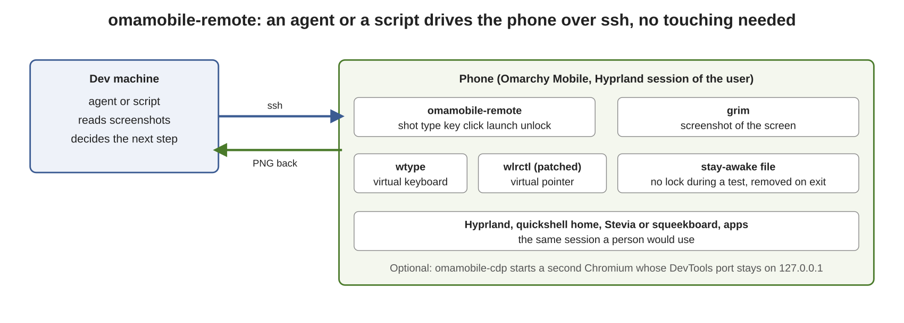
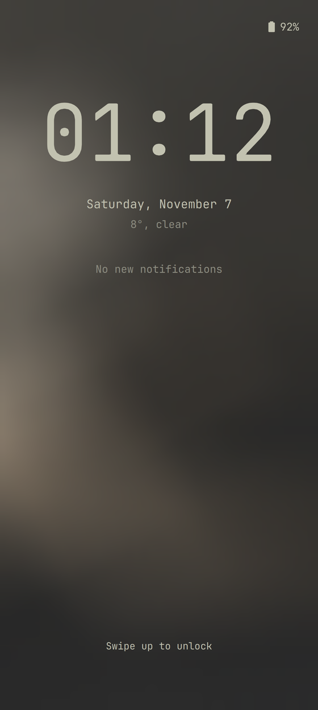
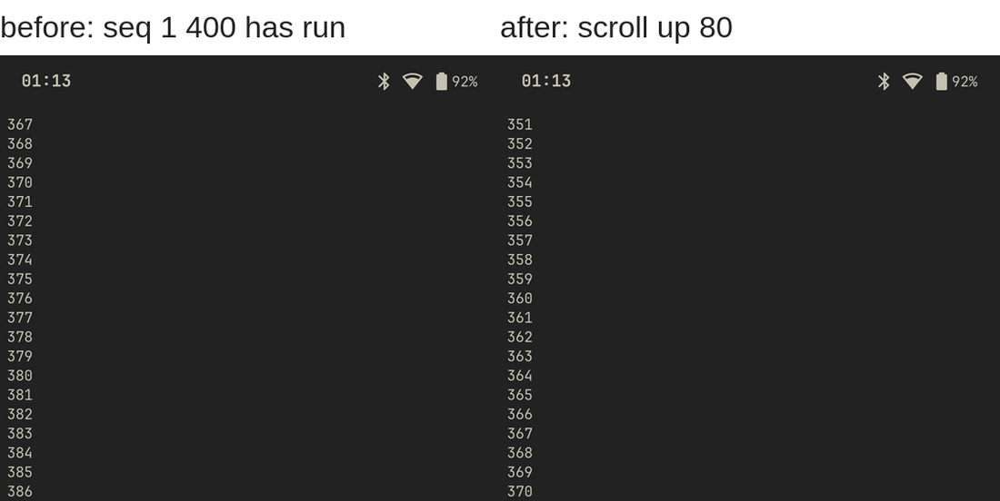
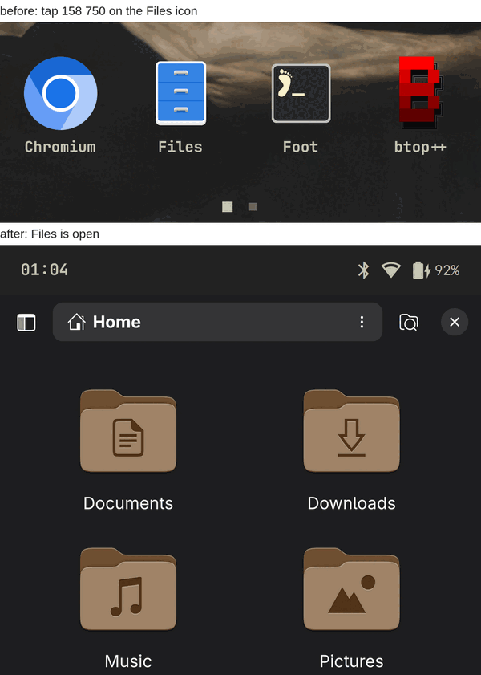
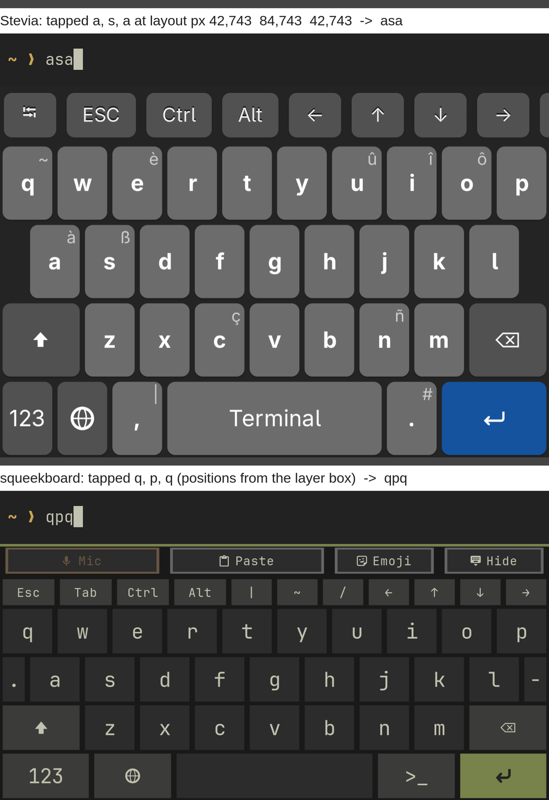
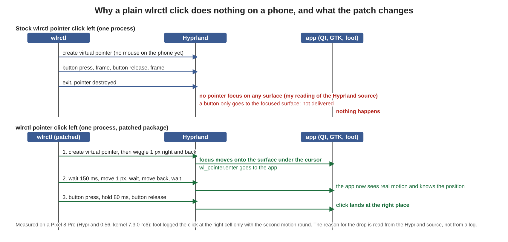

<!-- SPDX-License-Identifier: MIT -->
# Testing a phone over ssh with omamobile-remote

Most of bringing up a phone is trying things on it: does the speaker play, does the keyboard type, does the app open. This page shows how to do that with nobody holding the phone, so a script, or an AI agent, can run the checks and read the screen. Everything here was run on a Pixel 8 Pro (husky) on Hyprland 0.56, kernel 7.3.0-rc6, and the output shown is what that phone printed.



It is opt-in. `omamobile-remote` and the patched `wlrctl` are in `packages/`, no image installs them, and installing them enables nothing: no service, no udev rule, and nothing listens. (`omamobile-cdp` opens a port on 127.0.0.1 while you run it; see [Security](#security).) See [Security](#security).

`omamobile-mirror` is the other way in: a VNC window on your computer, with your own mouse and keyboard driving the phone, for demos and for typing. This is for scripts and agents: nothing to watch, no viewer, no open port, and every action and screenshot is a command with an exit code.

## Set up

On the phone, from the repository built by `tools/build-packages`:

```
pacman -U wlrctl-0.2.2-1-aarch64.pkg.tar.* omamobile-remote-0.1.0-1-any.pkg.tar.*
```

From your computer, an ssh key to the phone's user (USB networking is the easy way: `ssh user@172.16.42.1` on the images that have it). Every command below is run as that user:

```
ssh user@phone omamobile-remote help
```

The script finds the user's Wayland and Hyprland session by itself, so a plain ssh login is enough:

```
$ ssh user@phone omamobile-remote env
XDG_RUNTIME_DIR=/run/user/1000
WAYLAND_DISPLAY=wayland-1
HYPRLAND_INSTANCE_SIGNATURE=<instance>
DBUS_SESSION_BUS_ADDRESS=unix:path=/run/user/1000/bus
```

## The commands

| Command | What it does |
|---|---|
| `shot [-g "X,Y WxH"] [FILE]` | screenshot, prints the file name; wakes the display if it is off. Without FILE it writes `$XDG_RUNTIME_DIR/omamobile-shot-<time>.png`, which stays until you log out: delete it when you are done |
| `type TEXT` / `key KEYSYM [MOD...]` | type text, or one key (`key Tab shift`) with the virtual keyboard |
| `pos` / `move X Y` | read or set the pointer position |
| `click [left\|right\|middle]` / `tap X Y [BUTTON]` | click where the pointer is, or move and click |
| `scroll up\|down [N]` | scroll where the pointer is |
| `launch CMD...` | start an app in the session (no fake click needed) |
| `locked` / `lock` / `unlock` | exit 0 when locked; lock; unlock with the PIN from `$OMAMOBILE_PIN` or stdin |
| `keep-awake CMD...` | run a command while the phone is kept from locking, then put it back |
| `wake` | switch the display on |
| `osk status\|box\|switch NAME` | on-screen keyboard state, its rectangle, or swap squeekboard and Stevia |
| `run CMD...` | run any command with the session variables set |

## Coordinates

Pointer positions and screenshot geometries are in layout pixels, not panel pixels. On the Pixel 8 Pro the panel is 1344x2992 at scale 3.2, so the layout is 420x935. A full screenshot is 1344 px wide; `shot -g "0,607 420x284"` takes layout pixels and still returns a full-resolution crop. Read the numbers for your phone with `omamobile-remote run hyprctl monitors`. `hyprctl cursorpos` and `move` use the same layout pixels.

## A walk through

Every step below was done with `omamobile-remote` only.

**Lock and unlock.** `lock` locks the phone through the shell's own `omarchy-system-lock`, and `locked` says so with its exit code (0 locked, 1 unlocked, 2 when the shell cannot be asked). `unlock` takes the PIN on stdin and stops after one try:

```
$ ssh user@phone omamobile-remote lock
locked
$ ssh user@phone omamobile-remote shot lock.png
$ echo "$PIN" | ssh user@phone omamobile-remote unlock
unlocked
```



**Start an app, type, scroll.** `launch` starts it inside the session. The on-screen keyboard comes up by itself when a text field takes focus. Then run a command in the terminal and read the screen. The right-hand image is after `scroll up 80`: the earlier lines (351 to 386) have come back and the scrollbar is showing.

```
omamobile-remote launch foot
omamobile-remote type "seq 1 400"; omamobile-remote key Return
omamobile-remote tap 200 300          # focus the window under the pointer
omamobile-remote scroll up 80
```



**Click an icon.** `tap 158 750` moved the pointer onto the Files icon and clicked; Files opened (`hyprctl clients` shows `org.gnome.Nautilus`).



**Tap the on-screen keyboard.** Both keyboards took the same clicks and typed what was tapped. Stevia: `a`, `s`, `a` gave `asa`. squeekboard: `q`, `p`, `q` gave `qpq`.



### Finding keys on the on-screen keyboard

Ask for the keyboard's rectangle (layout pixels) and work out the key from the layout file, so nobody has to read pixels off a screenshot:

```
$ omamobile-remote osk status
process: 85850 /usr/bin/squeekboard
visible: true
layer: 0 695 420 196
$ omamobile-remote osk box
0 695 420 196
```

squeekboard stretches its layout to the full panel width and squeezes the rows to the panel height; it does not scale evenly. For the terminal layout's base view (`terminal/us.yaml`: rows 36, 32, 52, 52, 52 and 52 units high, 404.1 units wide), with the box `x y w h`:

```
key_x = x + units_from_left * w / 404.1
key_y = y + units_from_top  * h / 276
```

`q` is 20.2 units from the left (the letters are 40.41 wide) and the `q` row's middle is 94 units from the top, so on the box above `q` is at `0 + 20.2*420/404.1 = 21`, `695 + 94*196/276 = 762`, and `omamobile-remote tap 21 762` types it. The row with the `.` and `-` half-width keys, and every view you switch to (`123`, shift), has different units: read them from the yaml.

Stevia's layer is anchored the same way (`0 607 420 284` on this phone); its keys are in the build's own layout JSON, and the taps above (`a` at 42,743) were read from a screenshot of this layout.

To test both keyboards on one phone, `omamobile-remote osk switch squeekboard` and `osk switch stevia` move a Stevia user drop-in for `omamobile-osk.service` (`~/.config/systemd/user/omamobile-osk.service.d/stevia.conf`) aside and back, and restart the unit. With no such drop-in, `squeekboard` prints `squeekboard (no Stevia drop-in on this phone)` and `stevia` fails with a message. The keyboard is Stevia only on a phone where someone added that drop-in; the images ship squeekboard.

## Why a plain `wlrctl click` does nothing here

wlrctl makes a new virtual pointer for every command, sends the click and exits. A phone has no mouse, so Hyprland only has a pointer while wlrctl runs. A button goes to the surface that has pointer focus, and focus comes from pointer motion. A click with no motion before it has no surface to go to.



What was measured, with a terminal reporting mouse events as a target (`wtype x` typed into the same terminal was logged every time, so the logger was proven):

| Click sent by | Result |
|---|---|
| stock `wlrctl pointer click left` | nothing reaches the terminal |
| a version that moves 1 px and back once, waits, then clicks | the press and release arrive, but at cell 1;1 for every target: the app has no real motion yet |
| a version that adds a second motion round (move, wait, move back, wait) before the press, and holds the button 80 ms | the click arrives at the right cell (x=60 gave column 8, x=300 gave column 41); the home screen and both on-screen keyboards take it |

Scroll needs the same steps (scroll up gave button 64, down gave 65). `packages/wlrctl` is upstream wlrctl 0.2.2 with that change as one patch, with the measurements in its header. The reason a button is dropped without focus is read from the Hyprland 0.56.2 source, not from a Hyprland log; the measurements are what was observed. A click or a scroll takes 0.6 to 0.7 s (timed on the phone) because of the waits.

## Keeping the phone awake, and the display on

The shell locks after the idle time in `~/.config/omarchy/shell.json` (60 s on the test phone). `keep-awake` creates the file `~/.local/state/omarchy/indicators/stay-awake` that the shell's "stay awake" toggle uses, runs your command, and removes it again, unless it was already there. A TERM, HUP or Ctrl-C sent to `keep-awake` is passed on to your command, and the file is removed once the command has ended (the test suite checks TERM and HUP; Ctrl-C needs a real terminal). Only SIGKILL leaves the file behind: remove it with `omarchy-toggle-idle allow-idle`. The shell watches the file, so locking stops at once and starts again when it is removed. It does not unlock a locked phone and it does not switch the display on.

The display is a separate matter. On this phone hardware keys do not wake it (`key_press_enables_dpms` is off, as on Android), so a key sent over ssh does nothing to a dark screen, and `grim` waits for a frame that never comes. `shot` therefore checks the display, switches it on with `hyprctl dispatch 'hl.dsp.dpms({ action = "enable" })'` (the same dispatcher the phone uses to switch it off), and waits at most 10 s for `grim` on each of two tries.

```
ssh user@phone omamobile-remote keep-awake ./my-test.sh
```

## Writing an agent prompt

An agent can use this the way a person uses the phone, if it is told how to look first. A prompt that has worked:

```
You can use a phone over ssh: `ssh user@phone omamobile-remote <command>`
(run `omamobile-remote help`). Rules:
1. Look before you act: `shot`, then read the picture. After every action take
   another `shot` and say what changed. Stop when it did not change as expected.
2. If `locked` exits 0, unlock first, as its own command (the PIN comes in on
   stdin). Try the PIN once. Never retry a failed unlock. Then run the whole test
   inside `omamobile-remote keep-awake ...` so the phone does not lock under you.
3. Start apps with `launch`, not by tapping icons. Tap only what you must, with
   coordinates in layout pixels, not screenshot pixels.
4. Text goes through `type` and `key`. For the on-screen keyboard use `osk box`
   and the layout file to find a key, then `tap`.
5. Do not reboot, flash, change settings, install packages or touch audio levels
   unless the task says so. Close what you opened. Leave the phone locked or
   unlocked, as you found it.
6. Report what you did, each screenshot, and what you did not check.
```

Things that make an agent's run reliable: one action then one screenshot; check `locked` before blaming a command; read exit codes (`locked` has three); name the scale and the coordinate system in the prompt; stop on a blank screenshot (it prints a warning) instead of continuing blind.

## Security

- Everything runs as the user who ran it. The only way in is the ssh login you already have, and that login already controls the unlocked screen, so keep ssh to a key and to USB or a network you trust.
- The PIN is read from stdin or `$OMAMOBILE_PIN` and typed through the virtual keyboard from a pipe. It is never an argument, a log line or a file. If it came in through `$OMAMOBILE_PIN`, the script removes that variable from its environment as it starts, so what `keep-awake`, `run` and `launch` start never has it; the test suite checks the journal, the logs and those three environments. While `unlock` itself runs, the PIN is in the memory of that process. Do not put a real PIN in your shell history.
- Only the command name goes to the journal (`journalctl -t omamobile-remote`), never its arguments.
- `omamobile-cdp` starts a second Chromium with its own profile, so none of the real browser's cookies or logins are exposed, and the DevTools port is on 127.0.0.1 only (I checked with `ss -ltn`, and that it closes with the window). The port has no authentication, so while it is open any process of any user on the phone can drive that browser. Start it only for the test, and close it. It refuses `--remote-debugging-*`, `--user-data-dir` and `--remote-allow-origins` on its own command line. Reach it with `ssh -L 9222:127.0.0.1:9222 phone` and `/usr/lib/omamobile-remote/cdp.py`.

## Limits

Measured and working with the packaged tools: screenshots (full and cropped), typing, keys with modifiers, pointer move, left and right click, two clicks in a row, scroll up and down, `tap` at two positions in a terminal that reports mouse events, lock, unlock, launching apps, both on-screen keyboards, and `omamobile-cdp` with `cdp.py` (`list`, `eval`, `shot`).

Not done: drag (the wlrctl command line has no press, move, release in one process), the touchscreen itself (it would need `uinput`, which the test kernel does not build yet), long-press on a key, pinch and multi-finger gestures.

Not tested: other phones. The scale, the keyboard rectangle and the home-screen positions above are the Pixel 8 Pro's.

## Troubleshooting

| Symptom | Cause and fix |
|---|---|
| `shot` says "grim did not finish" | the display is off and `wake` did not help; check `hyprctl monitors` shows `dpmsStatus: 1` |
| `shot` warns the screenshot looks blank | taken while the screen was waking; run it again |
| `locked` exits 2 | the shell cannot be asked: it is not running, or `omarchy-shell` is missing |
| `unlock` says "still locked" | wrong PIN or the lock screen did not open; do not retry in a loop |
| a click does nothing | the stock `wlrctl` is first in `PATH`; install the `wlrctl` package from this repository |
| apps print a locale warning | the script takes `LANG` from the running shell; if that is unset it uses `C.UTF-8` |
