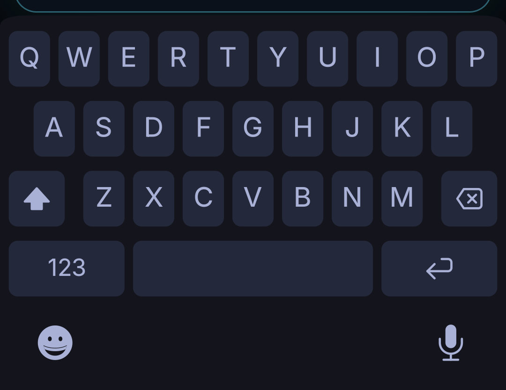
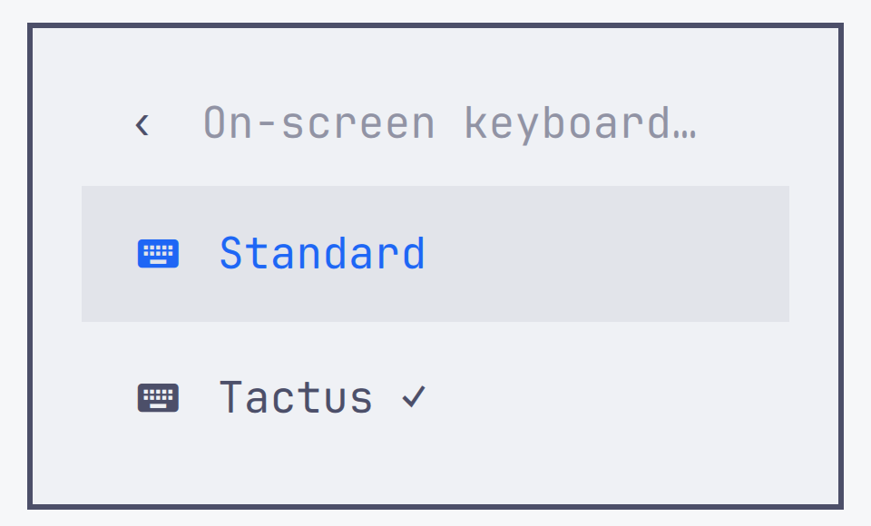
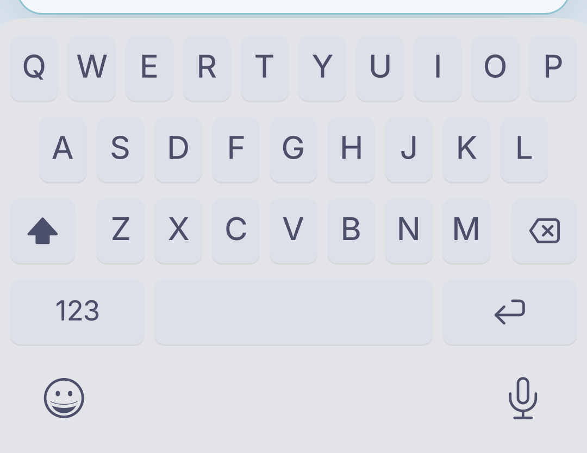

<!-- SPDX-License-Identifier: GPL-3.0-or-later -->
# tactus

Tactus is an on-screen keyboard an owner may choose instead of squeekboard. It corrects words as they are typed, the way the keyboards on current phones do. Opt-in: no image installs it, nothing depends on it, and squeekboard stays the phone's keyboard until the owner picks Tactus.

<p align="center">
  
</p>

It is built from [Stevia](https://gitlab.gnome.org/World/Phosh/stevia) 0.59.0 (GPL-3.0-or-later), whose Wayland side, layout files and emoji data it keeps. The keys, the emoji page and everything about what gets typed are written anew: seven patches to Stevia's files in `patches/`, each with what it does and why in its header, and Tactus's own sources in `source/` (the typing engine, the autocorrection, the drawing, what there is to paste) and `tools/` (its checks).

## Choosing it

Install the package, then Setup > Keyboard in Omarchy's menu (the gear in quick settings): Standard is squeekboard, Tactus is this one, and the one in use has a tick. Or from a terminal:

<p align="center">
   Keyboard: Standard, and Tactus with a tick">
</p>

```
omamobile-osk use tactus        # and back: omamobile-osk use squeekboard
omamobile-osk which
```

Both come with omamobile-shell's `omamobile-osk`, which starts the keyboard the owner chose (squeekboard instead, if Tactus fails at its start), and its `hypr/phone.lua` keeps Tactus's virtual keyboard out of the hardware-key binds, as it does squeekboard's. The choice is one word in `~/.config/omamobile/keyboard`. If Tactus is removed, the phone is back on squeekboard at the next start.

The package sits beside squeekboard: everything is under `/usr/lib/tactus`, with Stevia's settings schemas compiled there and the binary named `tactus`. (Arch's `stevia` package conflicts with squeekboard, which omamobile-shell needs.)

## What it does

- **Corrects a word when it is ended** (a space, a full stop, Return in running text). It weighs the word against what it could have been: where each finger landed in its key (a tap near a key's edge speaks for the neighbour), how common each word is, and the usual slips: two letters swapped, one missed or doubled, a missed space, a missing apostrophe (`dont`, `im`). A word the dictionary knows is replaced only when the taps themselves were close calls. Short forms people write (`btw`, `pics`, `msgs`, `vids`) stay, also at the start of a sentence. A rarer word, or one the word list doesn't count (`widget`), is offered when the taps point to it. A name typed with its capital in mid sentence is changed only by the taps, and only to a word or name the dictionary knows (`Vigip` to `Vigil`); with no close calls it stays as typed.
- **Weighs a word by the word before it.** Which word follows which comes from Tatoeba's English sentences (`word-pairs.txt`, see `WORD-PAIRS`): among the words a slip could have been, the one that fits after the word before is likelier, and a word the dictionary knows gives way to the one beside it only when its changed letters were close calls and the word before speaks for that one (`the bot` to `the boy`).
- **Looks back one word.** A word kept as typed is weighed again when the word after it is done, and changed only where the words either side speak far more for a word beside it, its changed letters close calls (`we ran out if the` to `we ran out of the`). Only when nothing was changed in between; Backspace right after puts it back.
- **Keys that lean toward the likely letter.** While a word is typed, a tap near the line between two letters goes to the one likelier next, by how often the words that begin so are written and what usually follows the word before. A tap in the middle of a key is always that key's, the keys don't change on screen, and nothing leans in a password field.
- **Backspace right after a correction puts back what was typed.** A word put back once is kept from then on (`~/.local/share/tactus/words.txt`).
- **Capitals:** a sentence starts with one, two spaces after a word make a full stop, a double tap on Shift locks it.
- **A long press** on a letter offers its accented forms. **Held on the space bar, the keyboard is a trackpad for the cursor:** the finger may go anywhere over it, slow motion moves the cursor a letter at a time and fast motion further, up and down move it a line, and a finger resting at the keyboard's left or right side keeps it going that way (twenty letters a second) until it moves back, so the far end of a long text is in reach. Backspace held deletes letters, then whole words. **Return held types a new line** where a tap on it would send what was written (a message, a search): it goes to the application as Return with Shift, and the line break appears while the key is still held.
- **An emoji page:** large emoji in four rows that slide sideways, the ones used lately first, a sign for each kind, a search by name, skin tones on a long press.
- **A microphone key** that starts the phone's dictation (`omamobile.voice`), and a swipe down that puts the keyboard away.
- **A Paste key** in the middle under the keys, between the emoji key and the microphone. **A tap pastes the last copy**; **held**, it opens Omarchy's clipboard list (`omarchy-menu-clipboard`), where a tap on an entry pastes that one. The tap pastes as an application does, with Shift and Insert from the keyboard's own virtual keyboard (what a pick in the clipboard list ends in): the text is never typed out, so a copy with a line break in it can't send a message half way through, and a picture pastes the same way. When the program the copy was made in has gone and the clipboard itself is empty, the tap pastes the newest entry of the clipboard's history, through the shell's own commands. This differs from squeekboard's Paste key, which opens the list on a tap. **The key is there only while there is something to paste:** text or a picture on the clipboard, or an entry in the history (`~/.local/state/omarchy/clipboard-history.json`). Tactus is told of both, by the compositor (the data-control protocol: only the kinds of data a copy is offered as, never the data) and by a file monitor, and asks neither on a timer; nothing else under the keys moves when the key comes or goes. **A press on it that travels is neither a tap nor a hold:** once the finger has moved more than 12 points from where it came down (a couple of millimetres on a phone), in any direction and wherever it goes afterwards, or the compositor has taken the touch for a gesture of its own, nothing happens. So a swipe up for the home screen or down to put the keyboard away may start on the key.
- **Past its round top corners the application shows,** not the wallpaper: the keyboard asks for a little less room than its panel is high (8 px on a screen 360 wide), so the window in front reaches that far under the panel's top. That much of the window's lower edge is behind the keyboard.
- It learns where the owner's fingers land (`~/.local/state/tactus/touch`) and shifts the keys' touch targets by it, within narrow limits.

Password fields get none of this: the typing engine is off wherever what is typed is hidden, and nothing typed into a field that asked for it (`sensitive data`) is learned.

## What it doesn't do

- **English only.** The dictionary is hunspell's en_US and the word counts are English. With another language's layout the keys type as they are, without corrections, and that has not been tried on a phone. There is no globe key and no way from Tactus to the shell's language sheet.
- **It corrects, it doesn't predict:** there is no row of suggestions. Stevia's own word completion is off: Tactus's settings default says so (`tactus.gschema.override`), and Stevia's hunspell completer looks for its dictionary under `/usr/lib/tactus` and finds none, which it says once at every start (`Failed to init default completer 'hunspell'`). That line in the journal is expected. Stevia's `osk-features` setting does nothing here: the keys are Tactus's own.
- **Context is one word either side.** The word pairs come from short, plain sentences, so they say little about technical writing, and a real word that fits the words around it stays.
- It knows how common the 50,000 commonest words are. A slip in a rarer form of a common word (`corects`) can stay as typed.
- **An application that doesn't say what its field is for gets corrections there too.** The typing engine runs only where a field's purpose is plain text (text-input's "normal"): a field that declares a password, a PIN, a number, a phone number, a name, an e-mail or web address, a date or a terminal gets each key as typed. But "normal" is also what a field that declares nothing reads as, so a GPUI editor or a terminal that doesn't say it is one is treated like a chat field. Backspace right after a correction puts the word back.
- **Not tried on the lock screen's password field.** The typing engine is off wherever the field says what is typed is hidden, as a password field should; whether the lock's field says so has not been checked on a phone, so until it has, unlock with squeekboard or the PIN pad if a password matters.
- The shell's home strip stays under it, as under squeekboard, so the microphone, paste and emoji keys sit above the strip.

## Its colours

Tactus draws itself in the applied Omarchy theme, as squeekboard is styled: the panel in the theme's darker background, the keys in its lighter one, the letters in its foreground, the caret in its accent (from `~/.local/state/omarchy/current/theme/colors.toml`). When Omarchy applies another theme the keyboard takes the new colours at once (it watches `theme.generation`): the keyboard at the top of this page in Tokyo Night, and here a moment after `omarchy-theme-set catppuccin-latte`.

<p align="center">
  
</p>

Without a theme file it uses light or dark colours of its own, by the desktop's setting. An owner who prefers those anyway can say so:

```
mkdir -p ~/.config/tactus && touch ~/.config/tactus/own-colours
```

## Text fields, and the browser

Every key is committed at once (no preedit), and the typing engine keeps its own copy of the text before the cursor.

- **A field that tells its text** (GTK, the browser) is held against that copy after every key. A word is replaced with `delete_surrounding_text`, and only once the field has shown everything sent before: a key that would take text away waits for that, a quarter of a second at most, and otherwise the word stays as typed.
- **A field that tells nothing** (GPUI applications) gets Backspace key presses and then the word. There the copy is built from Tactus's own keys alone, and any sign of life from the field that a key doesn't explain starts it afresh.
- **Chromium** (156, text-input-v3) sends new state only when the serial of the last `done` equals its count of commits, and Hyprland sends a text field `done` only when the keyboard commits something. Left alone, its surrounding text is one key behind, and since it takes text away counting from the cursor it last told of, a correction sent then deletes nothing and the right word lands after the wrong one. So Tactus answers: an empty input-method commit after a field's first sign of life and after every report that carries text (at most 40 a second). GTK applies nothing on an empty `done` and sends nothing back.

## The trace

`TACTUS_TRACE=1` in the keyboard's environment makes the typing engine say in the journal what it does and why: a word of so many letters kept or corrected, a field that tells its text or doesn't, a key that waited. It never says what was typed; `test/all --built` types a known text with the trace on and looks for it in the output.

## Tests

- `test/all` (offline; what `tests/packages` and CI run): the downloads are pinned, the patches are shaped as patches and touch the twelve files they should, the launcher, the licences.
- `test/all --upstream DIR`: the patches apply to the untouched Stevia tree with no fuzz.
- `test/all --built BUILD SRC` (the PKGBUILD's `check()`): the checks built with the keyboard. `tactus-typer-test` types against make-believe text fields (one that tells, one that tells nothing, a slow one, one that ignores deletes, a browser answered and unanswered): 126 checks. `tactus-ac-test` runs a list of slips and of words that must stay. `tactus-paste-test` checks which kinds of copy count, how the clipboard history's file is read, and that a change of the file is noticed without asking. Under `xvfb-run`, `tactus-kbd-test` and `tactus-emoji-test` drive the keys and the emoji page with no window on screen.

## Where it has run

On a Pixel 9a, as this package, chosen through Setup > Keyboard, in light on 2026-11-17 and in dark on 11-18: a GTK 3 text view (both days), Chromium 156 with text-input-v3 (a text area, an editable block and a one-line field: slips corrected, two spaces, Backspace, an emoji), and a GPUI application (a slip corrected, with the trace's line for it in a field that tells nothing). Changing to squeekboard and back from the menu worked both ways, and after each reboot the chosen keyboard was the one that started. It has been that phone's keyboard since. With the keyboard up the compositor kept 259 px for a panel 267 px high, the window in front ended 8 px under the panel's top, and no wallpaper showed past the corners, or between the window and the keyboard while the page changed from letters to emoji. Not tried: other languages' layouts, Qt applications, the lock screen's password field, a phone on its side, and any phone but the 9a.

## Licences

GPL-3.0-or-later, as Stevia (`COPYING`). The word counts (`en_50k.txt`) are from [FrequencyWords](https://github.com/hermitdave/FrequencyWords) by Hermit Dave, made from OpenSubtitles 2018, CC-BY-SA-4.0, installed unchanged; `WORD-COUNTS` has the commit. The emoji are the system's (Noto Color Emoji); the signs for their kinds and every icon on the keys are drawn in `tactus-draw.c`.
